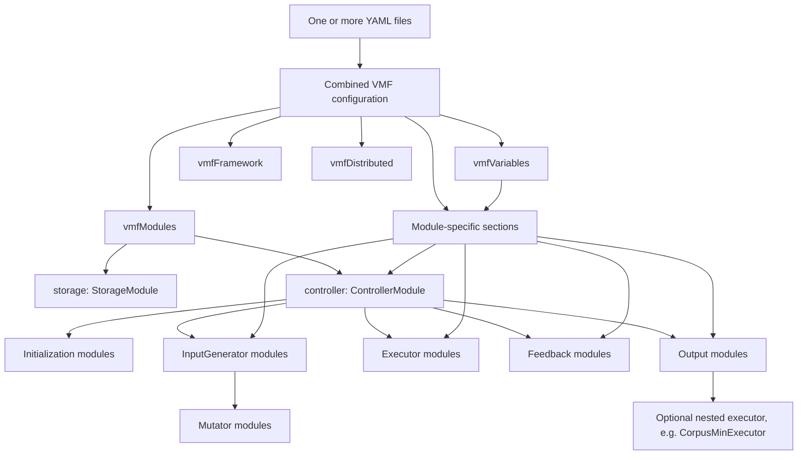

# VMF Configuration Space

This document describes VMF's configuration space: the choices that define a
fuzzing campaign, how those choices are represented in YAML, and the default
values VMF uses when a setting is omitted. The defaults table is based on the
current source code, with the existing configuration documentation used as
supporting context.

## Configuration Model

VMF is configured by one or more YAML files passed to `vader`. Those files are
combined into one YAML configuration. Each top-level YAML section should remain
within a single file, but SUT-specific settings can be separated from reusable
module graphs.

The configuration space has four main layers:

| Layer | Purpose |
| --- | --- |
| YAML composition | Split reusable VMF structure from SUT-specific anchors and paths. |
| Top-level sections | Define framework settings, module topology, reusable class sets, module-specific sections, and optional distributed settings. |
| Module graph | Select storage, a root controller, controller children, and nested submodules. |
| Module parameters | Tune behavior for each module instance by section name. |

The top-level sections are:

| Section | Required | Role |
| --- | --- | --- |
| `vmfVariables` | No | Defines YAML anchors and aliases for reused values such as `sutArgv` or `inputDir`. |
| `vmfFramework` | No | Framework-level settings such as output directory, logging, plugins, and RNG seed. |
| `vmfModules` | Yes | Declares the storage module, root controller, and module hierarchy. |
| `vmfDistributed` | Distributed mode only | Defines CDMS connection and polling behavior. |
| `vmfClassSet` | No | Defines reusable lists of module class names. |
| Module-specific sections | Module-dependent | Provides parameters for a module instance. |

## Module Graph

The module graph is declared under `vmfModules`. VMF requires one storage module
and one root controller module. Controller children and nested submodules define
which fuzzing components participate in the campaign.



The module graph has these naming rules:

| Rule | Behavior |
| --- | --- |
| `vmfModules.storage.className` | Required; selects the `StorageModule` implementation. |
| `vmfModules.controller.className` | Required; selects the root `ControllerModule`. |
| `children` | Optional YAML sequence of submodules under `controller` or under `vmfModules.<className-or-id>`. |
| `id` | Optional module instance name. If omitted, the instance name is the `className`. |
| Module-specific params | Read from the section named by module `id`, or by `className` when no `id` exists. |
| `classSet` | Expands a reusable list of class names. IDs are not supported in class-set entries. |

The practical configuration space can be viewed as these axes:

```text
VMF Configuration Space
+-- Campaign and SUT settings
|   +-- sutArgv, inputDir, bitcodeFilePath, grammar paths
|   +-- outputBaseDir, logLevel, seed, plugins
+-- Module topology
|   +-- storage
|   +-- controller
|   +-- controller children
|   +-- nested submodules
+-- Module behavior
|   +-- executor timeout, memory, debug, coverage, sanitizer settings
|   +-- input generator strategy and mutator choices
|   +-- feedback fitness weights
|   +-- output schedules and persistence settings
+-- Deployment mode
    +-- standalone
    +-- distributed CDMS campaign
```

## Defaults

`Required` means the parameter is read without a default and must be present
when that module or mode is used. `Presence-based` means the parameter changes
behavior only when present.

### Framework And Storage

| Section | Parameter | Default | Notes |
| --- | --- | --- | --- |
| `vmfFramework` | `outputBaseDir` | `output` | Base output directory. |
| `vmfFramework` | `logLevel` | `3` | `0=Debug`, `1=Info`, `2=Warning`, `3=Error`. |
| `vmfFramework` | `additionalPluginsDir` | Not present | Optional list of plugin directories; only read when present. |
| `vmfFramework` | `seed` | `0` | `0` selects a random seed; nonzero initializes reproducible RNG state. |
| Storage instance, usually `SimpleStorage` | `sortByKey` | `FITNESS` | Read by the application when configuring `StorageRegistry`. |
| Storage instance, usually `SimpleStorage` | `sortByType` | `FLOAT` | Valid values include `INT`, `UINT`, `U64`, `FLOAT`, `BUFFER`, `BUFFER_TEMP`; storage cannot sort usefully by buffer types. |
| Storage instance, usually `SimpleStorage` | `sortOrder` | `DESCENDING` | Valid values are `ASCENDING` and `DESCENDING`. |

### Controllers

| Module | Parameter | Default | Notes |
| --- | --- | --- | --- |
| Common controller base | `runTimeInMinutes` | `0` | `0` means run until stopped manually. |
| Common controller base | `keepAllSeeds` | `true` | If false, only interesting seeds are kept. |
| `BalancedController` | `epochLengthInMinutes` | `30` | Length of each balancing epoch. |
| `BalancedController` | `balanceMetric` | `time` | Valid values: `time`, `uses`, `testcasesGenerated`. |
| `NewCoverageController` | `primaryInputGenerator` | Required | Name of the primary input generator submodule. |
| `NewCoverageController` | `newCoverageInputGenerator` | Required | Name of the input generator to use after new coverage. |
| `IterativeController` | Module-specific params | None | Uses common controller parameters. |
| `RunOnceController` | Module-specific params | None | Uses common controller parameters. |
| `AnalysisController` | Module-specific params | None | Uses common controller parameters. |

### Initialization Modules

| Module | Parameter | Default | Notes |
| --- | --- | --- | --- |
| `DirectoryBasedSeedGen` | `inputDir` | Required | Directory containing initial seed files. |
| `GramatronBasedSeedGen` | `PDAPath` | Required | JSON pushdown automata path. The source reads `PDAPath`. |
| `GramatronBasedSeedGen` | `numTestCases` | Required | Number of grammar-generated seed cases. |
| `TrivialSeedInitialization` | Module-specific params | None | Creates the built-in `hello` seed. |
| `DictionaryInitialization` | `sutArgv` | Required | Uses the first entry as the SUT path for string extraction. |
| `KleeInitialization` | `bitcodeFilePath` | Required | LLVM bitcode path. |
| `StringsInitialization` | `sutArgv` | Required | Uses the first entry as the SUT path for `strings`. |

### Input Generators And Mutators

| Module | Parameter | Default | Notes |
| --- | --- | --- | --- |
| `GeneticAlgorithmInputGenerator` | `enableMutationOfCrashes` | `false` | Selects whether crashed or hung cases can be mutated. |
| `MOPTInputGenerator` | `numSwarms` | `5` | Number of particle swarms. |
| `MOPTInputGenerator` | `pilotPeriodLength` | `50000` | Test cases per swarm during pilot phase. |
| `MOPTInputGenerator` | `corePeriodLength` | `500000` | Test cases in the core period. |
| `MOPTInputGenerator` | `pMin` | `0` | `0` means MOPT computes an adaptive minimum. |
| `RedPawnInputGenerator` | `maxTimePerSeedInSeconds` | `600` | `0` disables the per-seed time limit. |
| `RedPawnInputGenerator` | `colorizeMaxExecs` | `1000` | Execution bound for colorization. |
| `RedPawnInputGenerator` | `batchSize` | `1000` | Number of generated cases per batch. |
| `RedPawnInputGenerator` | `skipStaticLogEntries` | `true` | Enables static-log-entry optimization. |
| `RedPawnInputGenerator` | `alwaysCreatePlusMinusOne` | `false` | Always create `+/- 1` variations when true. |
| `RedPawnInputGenerator` | `useDirectTransform` | `true` | Enables direct encoding transform. |
| `RedPawnInputGenerator` | `useReverseBytesTransform` | `true` | Enables reverse-byte encoding transform. |
| `RedPawnInputGenerator` | `useOffsetTransform` | `true` | Enables offset arithmetic transform. |
| `RedPawnInputGenerator` | `useFactorTransform` | `true` | Enables factor arithmetic transform. |
| `RedPawnInputGenerator` | `useXORTransform` | `true` | Enables XOR arithmetic transform. |
| `RedPawnInputGenerator` | `useDirectStringTransform` | `true` | Enables direct string transform. |
| `RedPawnInputGenerator` | `useToLowerStringTransform` | `false` | Enables lowercase string transform. |
| `RedPawnInputGenerator` | `useToUpperStringTransform` | `false` | Enables uppercase string transform. |
| `DictionaryMutator` | `dictionaryPaths` | `[]` | Optional list of dictionary files. |
| `StackedMutator` | `stackSize` | Number of child mutators | Cannot be zero. |
| `StackedMutator` | `randomStackSize` | `false` | Uses fixed stack size by default. |
| `StackedMutator` | `mutatorSelector` | `staticMutatorSelector` | Valid source values: `staticMutatorSelector`, `uniformMutatorSelector`, `WeightedRandomSelector`. |
| `WeightedRandomSelector` | `mutatorSelectionDistribution` | Required when selected | Float list; must match mutator count and be normalized. |
| AFL bit/byte/random/delete/clone/splice mutators | Module-specific params | None | No direct config reads. |
| Gramatron mutators | Module-specific params | None found through `ConfigInterface` reads | They depend on grammar-related storage created by Gramatron seed generation. |

### Executors

| Module | Parameter | Default | Notes |
| --- | --- | --- | --- |
| `AFLForkserverExecutor` | `sutArgv` | Required | SUT command line. Presence of `@@` selects file-based test delivery; otherwise stdin is used. |
| `AFLForkserverExecutor` | `ignoreHangs` | `false` | Treats timeouts as non-hangs when true. |
| `AFLForkserverExecutor` | `enableCoreDumpCheck` | `true` | Verifies core pattern unless disabled. |
| `AFLForkserverExecutor` | `enableAFLDebug` | `false` | Enables AFL debug behavior. |
| `AFLForkserverExecutor` | `debugLog` | `false` | Redirects SUT stdout/stderr to files when true. |
| `AFLForkserverExecutor` | `stdout` | `stdout` | Used only when `debugLog` is true and the parameter is present. |
| `AFLForkserverExecutor` | `stderr` | `stderr` | Used only when `debugLog` is true and the parameter is present. |
| `AFLForkserverExecutor` | `timeoutInMs` | Presence-based | When omitted, VMF calibrates timeout and falls back to `1000ms` if calibration cannot determine one. |
| `AFLForkserverExecutor` | `memoryLimitInMB` | `128` | If `useASAN=true` and this is omitted, memory limit becomes `0` unlimited. |
| `AFLForkserverExecutor` | `mapSize` | Presence-based | When omitted, VMF autodetects and falls back to `8388608` bytes. |
| `AFLForkserverExecutor` | `maxCalibrationCases` | `300` | Maximum seed cases used for calibration. |
| `AFLForkserverExecutor` | `alwaysWriteTraceBits` | `false` | Always writes trace bits when true. |
| `AFLForkserverExecutor` | `traceBitsOnNewCoverage` | `true` | Writes trace bits only for new coverage when true. |
| `AFLForkserverExecutor` | `writeStats` | `true` | Writes cumulative coverage metadata. |
| `AFLForkserverExecutor` | `customExitCode` | Presence-based | Enables custom crash exit-code detection when present. |
| `AFLForkserverExecutor` | `cmpLogEnabled` | `false` | Enables CmpLog shared-memory handling. |
| `AFLForkserverExecutor` | `useASAN` | `false` | AddressSanitizer mode. |
| `AFLForkserverExecutor` | `useLSAN` | `false` | LeakSanitizer mode. |
| `AFLForkserverExecutor` | `useMSAN` | `false` | MemorySanitizer mode. |
| `AFLForkserverExecutor` | `useUBSAN` | `false` | UndefinedBehaviorSanitizer mode. |
| `FridaExecutor` | `sutArgv` | `vmf_frida_rtentry.exe` from the VMF binary directory | Windows Frida runtime entrypoint. |
| `FridaExecutor` | `ignoreTimeouts` | `false` | Windows executor timeout-ignore setting. |
| `FridaExecutor` | `debugLog` | `false` | Redirects SUT stdout/stderr when true. |
| `FridaExecutor` | `stdout` | `stdout` | Also causes redirection when present. |
| `FridaExecutor` | `stderr` | `stderr` | Also causes redirection when present. |
| `FridaExecutor` | `timeoutInMs` | `1000` | Manual timeout duration. |
| `FridaExecutor` | `memoryLimitInMB` | `128` | SUT memory limit. |
| `FridaExecutor` | `mapSize` | `65536` | Fixed Frida map size; not configurable through YAML. |
| `FridaExecutor` | `alwaysWriteTraceBits` | `false` | Always writes trace bits when true. |
| `FridaExecutor` | `traceBitsOnNewCoverage` | `true` | Writes trace bits only for new coverage when true. |
| `FridaExecutor` | `writeStats` | `true` | Writes cumulative coverage metadata. |

### Feedback

| Module | Parameter | Default | Notes |
| --- | --- | --- | --- |
| `AFLFeedback` | `useCustomWeights` | `false` | Enables custom fitness weighting. |
| `AFLFeedback` | `sizeWeight` | `1.0` | Used when custom weighting is active. |
| `AFLFeedback` | `speedWeight` | `5.0` | Used when custom weighting is active. |
| `AFLFavoredFeedback` | `useCustomWeights` | `false` | Inherited from `AFLFeedback`. |
| `AFLFavoredFeedback` | `sizeWeight` | `1.0` | Inherited from `AFLFeedback`. |
| `AFLFavoredFeedback` | `speedWeight` | `5.0` | Inherited from `AFLFeedback`. |
| `AFLFavoredFeedback` | `favoredWeight` | `5.0` | Multiplier for favored test cases. |

### Output Modules

| Module | Parameter | Default | Notes |
| --- | --- | --- | --- |
| `ComputeStats` | `statsRateInSeconds` | `1` | Rate for full stats recomputation. |
| `CorpusMinimization` | `frequencyInMinutes` | `30` | `0` disables periodic minimization and leaves shutdown-only behavior. |
| `CorpusMinimization` | `minimizeOnShutdown` | `true` | Runs minimization during shutdown when true. |
| `CSVMetadataOutput` | `outputRateInSeconds` | `5` | CSV write interval. |
| `CSVMetadataOutput` | `outputFileName` | `metadata.csv` | Written under VMF output directory. |
| `LoggerMetadataOutput` | `outputRateInSeconds` | `5` | Metadata logging interval. |
| `SaveCorpusOutput` | `tagsToSave` | `["CRASHED", "HUNG"]` | Unique saved cases are always written under `testcases/unique`. |
| `SaveCorpusOutput` | `recordTestMetadata` | `false` | Records mutator IDs next to saved tests when true. |
| `StatsOutput` | `sendToServer` | `false` | Sends stats to CDMS when true; see distributed mode. |
| `StatsOutput` | `outputRateInSeconds` | `5` or `20` | Default is `5`; if `sendToServer=true`, default becomes `20`. |

## Distributed Mode

Distributed mode adds CDMS connection settings and several server-facing modules.
These options are separated here because they are not needed for a standalone VMF
campaign.

### Distributed Relationships

| Relationship | Description |
| --- | --- |
| `vmfDistributed` -> `CDMSClient` | Provides server URL, proxy, retry behavior, client name, and tasking poll cadence. |
| Controller instance -> `CDMSCommandAndCorpusHandler` | Controller-level CDMS options control batch size and corpus update cadence. |
| Server initialization modules -> CDMS corpus | `ServerSeedInitialization` and `ServerCorpusInitialization` retrieve seed or corpus data from the server. |
| Server output modules -> CDMS corpus | `ServerCorpusOutput`, `ServerCorpusMinOutput`, and `StatsOutput.sendToServer` publish data back to CDMS. |
| `writeServerURL` -> storage | `ServerCorpusInitialization.writeServerURL` writes `FILE_URL` metadata used by distributed corpus minimization. |

### Distributed Defaults

| Module / Section | Parameter | Default | Notes |
| --- | --- | --- | --- |
| `vmfDistributed` | `serverURL` | Required | Required when running in distributed mode. |
| `vmfDistributed` | `proxyURL` | `""` | Empty string means no configured proxy. |
| `vmfDistributed` | `clientName` | `VMF_instance` | Human-readable distributed client name. |
| `vmfDistributed` | `retryTimeout` | `30000` | Milliseconds between CDMS retries. |
| `vmfDistributed` | `retryCount` | `10` | Number of CDMS retries. |
| `vmfDistributed` | `taskingPollRate` | `10000` | Milliseconds between tasking polls. |
| `vmfDistributed` | `taskingInitialRandomDelayMax` | `-1` | `-1` disables the initial random delay. |
| Controller instance | `batchSize` | `1000` | Used when controllers interact with CDMS corpus loading or updates. |
| Controller instance | `corpusUpdateRateMins` | `5` | CDMS corpus update rate. |
| Controller instance | `corpusInitialUpdateMins` | `5` | Initial CDMS corpus update delay. |
| Controller instance | `corpusUpdateTags` | `["RAN_SUCCESSFULLY"]` | Tags selected for corpus update behavior. |
| `ServerSeedInitialization` | `corpusTags` | `["RAN_SUCCESSFULLY"]` | Source reads `corpusTags`. |
| `ServerSeedInitialization` | `getMinCorpus` | `true` | Requests minimized corpus when true. |
| `ServerCorpusInitialization` | `writeServerURL` | `true` | Writes CDMS file URL to storage when true. |
| `ServerCorpusInitialization` | `corpusTags` | `[""]` | Empty tag string retrieves all tags. |
| `StatsOutput` | `sendToServer` | `false` | Sends stats to CDMS when true. |
| `StatsOutput` | `outputRateInSeconds` | `5` or `20` | Default is `5`; if `sendToServer=true`, default becomes `20`. |
| `ServerCorpusOutput` | `serverDelayTimeinSecs` | `30` | Source spelling uses lowercase `in` in `Timein`. |
| `ServerCorpusOutput` | `serverDelayOverrideCount` | `-1` | `-1` disables override behavior. |
| `ServerCorpusMinOutput` | Module-specific params | None found through `ConfigInterface` reads | Uses distributed corpus minimization behavior. |

## Source Notes

The following settings are source-backed and easy to miss when reading only the
existing docs:

| Area | Source-backed detail |
| --- | --- |
| Server seed initialization | Source reads `corpusTags` and `getMinCorpus`; older prose may describe different names. |
| Gramatron seed generation | Source reads `PDAPath`. |
| Server corpus output | Source reads `serverDelayTimeinSecs`, including that spelling. |
| Windows Frida executor | Uses `ignoreTimeouts`, while the Linux AFL forkserver executor uses `ignoreHangs`. |
| Storage sort options | Read by `VmfApplication`, not by `SimpleStorage::init`. |
| Common controller settings | `runTimeInMinutes` and `keepAllSeeds` are inherited by controller implementations. Distributed controller options are listed separately. |
| Stacked mutator selection | `mutatorSelector` can select static, uniform, or weighted random behavior; weighted random requires `mutatorSelectionDistribution`. |

To refresh this reference after adding modules, scan for configuration reads:

```bash
rg -n "get(String|StringVector|Int|IntVector|Float|FloatVector|Bool)Param\\(|isParam\\(" vmf/src
```
